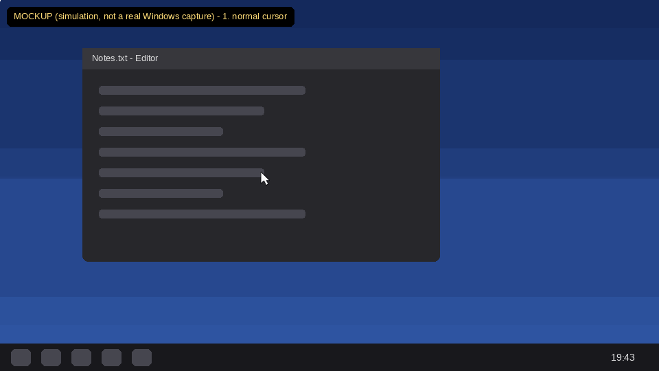
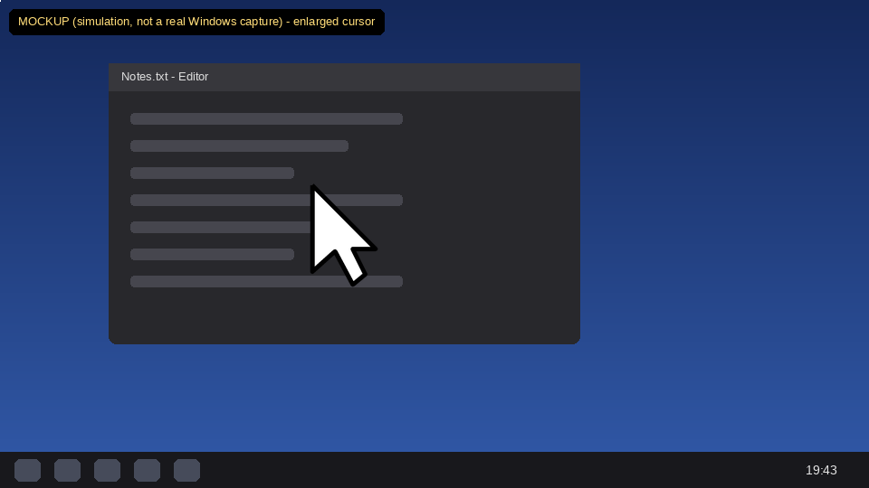
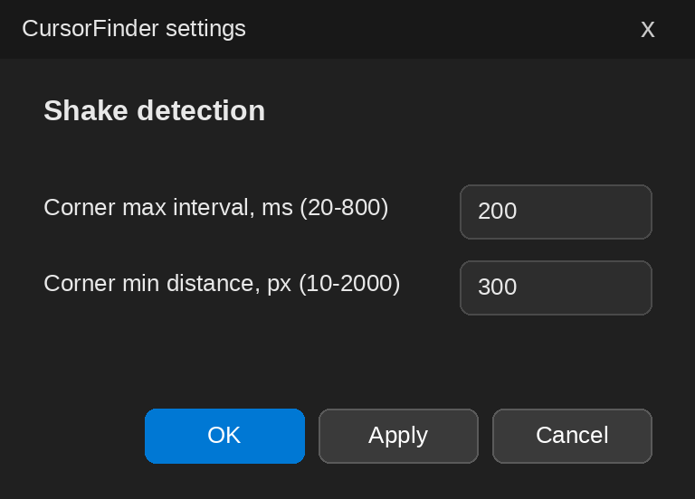
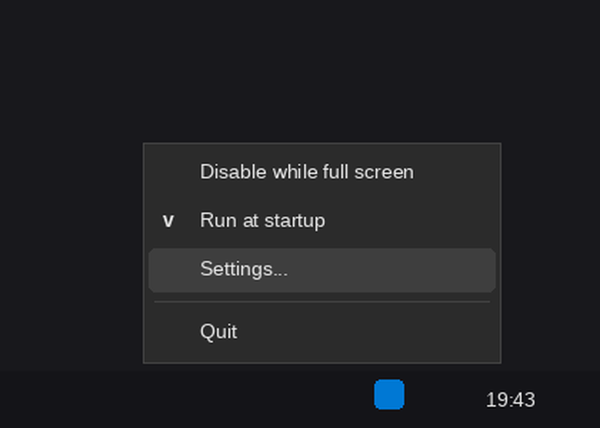

# CursorFinder (Rust)

`Shake to Find Cursor` for Windows: shake the mouse and the cursor grows big
so you never lose it on screen. Rust rewrite of the original Qt/C++
[CursorFinder](https://github.com/MrBeanCpp/CursorFinder).



> **About the images.** The GIF and screenshots in `docs/` are **mockups drawn
> by a script** (`docs/make_mockups.py`) that reproduces the layout, colors and
> arrow shape from the source code. They are **not captures from a real Windows
> machine**. Real rendering may differ slightly (fonts, DPI, animation timing).

## What it does

CursorFinder works like macOS "Shake mouse pointer to locate": shake the mouse and the pointer grows, keep shaking and it stays big, stop and it shrinks back. It is a Windows implementation of that behaviour, not an Apple product or a copy of Apple's code.

- Shake the mouse: the cursor grows in place (30 -> 110 px, sharp vector arrow).
- While it is enlarged, the small system arrow is hidden, so you never see two cursors.
- It stays big while you keep moving and shrinks about 300 ms after you stop.
- Works on every monitor, per-monitor DPI aware, tray icon survives Explorer restarts.

## Install

1. Quit any older CursorFinder from its tray menu.
2. Extract the zip anywhere and run `CursorFinder.exe` (no installer, no extra DLLs).
3. Right-click the tray icon for the menu. Tick `Run at startup` to start it with Windows.

Windows 10/11 x64 only. It is a pure Win32/GDI app and does not run on Linux or macOS.

## Screenshots (mockups)

| Enlarged cursor | Settings | Tray menu |
|---|---|---|
|  |  |  |

## How it works

Every 20 ms the app looks at the last three cursor positions. A direction
change sharper than 90 degrees counts as a "corner". Two corners within
`GapTime` ms and at least `Distance` px apart mean you are shaking the mouse,
so an enlarged cursor fades in on top of the real one (30 -> 110 px over
100 ms). Once enlarged, ANY significant pointer movement keeps it enlarged -
the shake rhythm no longer matters, so a steady shake never flickers at
direction changes. 300 ms without significant movement counts as a stop;
shrinking then runs over 200 ms, so the cursor is back to normal within
500 ms of the last movement. Only a confirmed shake can enlarge the cursor,
so casual movement never triggers it. Resuming a shake during shrink grows
it smoothly from its current size.
Windows timer delivery can add scheduling jitter (the follow timer is 10 ms).

The enlarged cursor is a small layered (per-pixel alpha) window centered on
the cursor - no full-screen overlay, no Qt. By default the arrow is drawn
as an anti-aliased GDI+ polygon at the animated size, so it is crisp at
every scale (a `cursor.*` file next to the exe still overrides it with a
custom image).

## Usage

- Put `CursorFinder.exe` anywhere and run it. It lives in the system tray.
- Tray menu:
  - `Disable while full screen` - don't trigger over full screen apps (games, video)
  - `Run at startup` - adds/removes a `HKCU\...\Run` registry entry
  - `Settings...` - corner max interval (ms, 20-800) and corner min distance (px, 10-2000)
  - `Quit`
- Settings are stored in `settings.ini` next to the exe (same keys as the
  original: `[General]` GapTime / Distance / DetectFullScreen).

## Custom cursor image

Place a file named `cursor.*` next to the exe to replace the built-in image,
e.g. `cursor.cur`, `cursor.ico`, `cursor.png`, `cursor.jpg`, `cursor.jpeg`.

## Build

```
rustup target add x86_64-pc-windows-msvc   # or -gnu
cargo build --release
```

A prebuilt release exe (x86_64, no extra runtime DLLs, only Windows system
DLLs; Windows 10/11 x64 recommended) is included next to this README for convenience.

